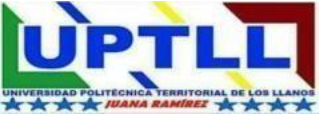

<div align="center">
  
</div>

---

<!-- PÁGINA 1: PORTADA EXTERNA (CARÁTULA AZUL OSCURO) -->
<div align="center">

**REPÚBLICA BOLIVARIANA DE VENEZUELA**  
**MINISTERIO DEL PODER POPULAR PARA LA EDUCACIÓN UNIVERSITARIA**  
**UNIVERSIDAD POLITÉCNICA TERRITORIAL DE LOS LLANOS "JUANA RAMÍREZ"**  
**NÚCLEO VALLE DE LA PASCUA – DEPARTAMENTO DE INFORMÁTICA**  
**PROGRAMA NACIONAL DE FORMACIÓN EN INFORMÁTICA – TRAYECTO III**  

<br><br><br>

### **DESARROLLO DE UN SISTEMA WEB MEDIZEN PARA LA GESTIÓN DE HISTORIAS CLÍNICAS MULTIESPECIALIDAD Y CONTROL OPERATIVO EN LA CLÍNICA FEMESALUD, VALLE DE LA PASCUA ESTADO GUÁRICO**

<br><br>
*(Carátula Oficial: Color Azul Oscuro)*  
<br><br>

**Autores:**  
Kevin Quintero, C.I. V-32.276.060  
Charlys Villarroel, C.I. V-32.337.825  

**Tutor Académico:**  
Prof. Jose Alfredo Sanchez  

<br><br><br>

**Valle de la Pascua, Abril de 2026**

</div>

<div style="page-break-after: always;"></div>

---

<!-- PÁGINA 2: PORTADA INTERNA -->
<div align="center">

  

**REPÚBLICA BOLIVARIANA DE VENEZUELA**  
**MINISTERIO DEL PODER POPULAR PARA LA EDUCACIÓN UNIVERSITARIA**  
**UNIVERSIDAD POLITÉCNICA TERRITORIAL DE LOS LLANOS "JUANA RAMÍREZ"**  
**NÚCLEO VALLE DE LA PASCUA – DEPARTAMENTO DE INFORMÁTICA**  
**PROGRAMA NACIONAL DE FORMACIÓN EN INFORMÁTICA – TRAYECTO III**  

<br><br>

### **DESARROLLO DE UN SISTEMA WEB MEDIZEN PARA LA GESTIÓN DE HISTORIAS CLÍNICAS MULTIESPECIALIDAD Y CONTROL OPERATIVO EN LA CLÍNICA FEMESALUD, VALLE DE LA PASCUA ESTADO GUÁRICO**

<br>

*Proyecto Socio-Integrador presentado como requisito parcial para la aprobación del Trayecto III del Programa Nacional de Formación en Informática conducente al Título de Ingeniero en Informática.*

<br><br>

**Autores:**  
Kevin Quintero, C.I. V-32.276.060  
Charlys Villarroel, C.I. V-32.337.825  

**Tutor Académico:**  
Prof. Jose Alfredo Sanchez  

**Asesora Comunitaria / Institucional:**  
Dra. Carli Sole (y equipo médico)  
*(Especialista en Múltiples Especialidades Médicas - Clínica FemeSalud)*  

<br><br>

**Valle de la Pascua, Abril de 2026**

</div>

<div style="page-break-after: always;"></div>

---

<!-- PÁGINA 3: ACTA DE APROBACIÓN DEFINITIVA DEL PROYECTO (FORMATO N.º 9 UPTLLJR) -->

### **ACTA DE APROBACIÓN DEFINITIVA DEL PROYECTO**

En atención a lo dispuesto en la normativa académica vigente y según lo establecido por el Consejo Universitario de la **UNIVERSIDAD POLITÉCNICA TERRITORIAL DE LOS LLANOS "JUANA RAMÍREZ" (UPTLLJR)** en la sesión extraordinaria N.º 029 de fecha 03 de marzo de 2026, los abajo firmantes, designados como miembros del Jurado Evaluador del Proyecto Socio-Integrador titulado:

> **"DESARROLLO DE UN SISTEMA WEB MEDIZEN PARA LA GESTIÓN DE HISTORIAS CLÍNICAS MULTIESPECIALIDAD Y CONTROL OPERATIVO EN LA CLÍNICA FEMESALUD, VALLE DE LA PASCUA ESTADO GUÁRICO"**

Presentado por los estudiantes cursantes del Programa Nacional de Formación en Informática (Trayecto III):
* **Kevin Quintero**, Cédula de Identidad: **V-32.276.060**
* **Charlys Villarroel**, Cédula de Identidad: **V-32.337.825**

Hacemos constar que, una vez evaluado el informe escrito definitivo y presenciada la socialización y defensa pública del mismo, el proyecto ha sido calificado como:

**APROBADO** con una calificación cualitativa / cuantitativa de: _________________ (___ pts).

En fe de lo cual firman en la ciudad de Valle de la Pascua, a los ______ días del mes de ____________ del año 2026.

<br>

__________________________________________  
**Prof. Jose Alfredo Sanchez**  
C.I.: __________________  
*Tutor Académico*  

<br>

__________________________________________ &nbsp;&nbsp;&nbsp;&nbsp;&nbsp;&nbsp;&nbsp;&nbsp;&nbsp;&nbsp;&nbsp;&nbsp;&nbsp;&nbsp;&nbsp;&nbsp;&nbsp;&nbsp;&nbsp;&nbsp; __________________________________________  
**Jurado Evaluador 1** &nbsp;&nbsp;&nbsp;&nbsp;&nbsp;&nbsp;&nbsp;&nbsp;&nbsp;&nbsp;&nbsp;&nbsp;&nbsp;&nbsp;&nbsp;&nbsp;&nbsp;&nbsp;&nbsp;&nbsp;&nbsp;&nbsp;&nbsp;&nbsp;&nbsp;&nbsp;&nbsp;&nbsp;&nbsp;&nbsp;&nbsp;&nbsp;&nbsp;&nbsp;&nbsp;&nbsp;&nbsp;&nbsp;&nbsp;&nbsp;&nbsp;&nbsp;&nbsp;&nbsp;&nbsp;&nbsp;&nbsp;&nbsp;&nbsp;&nbsp;&nbsp;&nbsp;&nbsp;&nbsp; **Jurado Evaluador 2**  
C.I.: __________________ &nbsp;&nbsp;&nbsp;&nbsp;&nbsp;&nbsp;&nbsp;&nbsp;&nbsp;&nbsp;&nbsp;&nbsp;&nbsp;&nbsp;&nbsp;&nbsp;&nbsp;&nbsp;&nbsp;&nbsp;&nbsp;&nbsp;&nbsp;&nbsp;&nbsp;&nbsp;&nbsp;&nbsp;&nbsp;&nbsp;&nbsp;&nbsp;&nbsp;&nbsp;&nbsp;&nbsp;&nbsp;&nbsp;&nbsp;&nbsp;&nbsp;&nbsp;&nbsp;&nbsp;&nbsp;&nbsp;&nbsp; C.I.: __________________  

<div style="page-break-after: always;"></div>

---

<!-- DEDICATORIA (OPCIONAL) -->

### **DEDICATORIA**

*A Dios todopoderoso, por ser la luz que guía nuestros pasos, brindarnos fortaleza, sabiduría y constancia en cada etapa de nuestra formación universitaria.*

*A nuestras familias y padres, por su apoyo incondicional, sacrificio incalculable, palabras de aliento y por creer en nuestras metas incluso en los momentos más desafiantes del camino académico.*

*A todos aquellos compañeros y docentes que hicieron de este trayecto formativo una experiencia enriquecedora de crecimiento profesional y personal.*

<div style="page-break-after: always;"></div>

---

<!-- AGRADECIMIENTOS (OPCIONAL) -->

### **AGRADECIMIENTO**

A la **Universidad Politécnica Territorial de los Llanos "Juana Ramírez" (UPTLLJR)**, y en particular al Departamento del Programa Nacional de Formación en Informática, por abrirnos sus aulas y brindarnos una sólida formación tecnológica y comunitaria orientada a la transformación del entorno social.

A nuestro Tutor Académico, el **Prof. Jose Alfredo Sanchez**, por su asesoría metodológica permanente, paciencia, dedicación e invaluables orientaciones técnicas que permitieron darle forma y rigor científico a cada una de las fases de este proyecto.

A la **Dra. Carli Sole (y equipo médico)** y al equipo de la **Clínica FemeSalud**, por abrirnos generosamente las puertas de su consultorio, depositar su plena confianza en nuestra propuesta tecnológica, brindar su tiempo y suministrar los requerimientos clínicos esenciales para la concepción y puesta en marcha del sistema.

A nuestros profesores y facilitadores universitarios, que con su vocación y ejemplo pedagógico nos inspiraron a emplear las tecnologías de la información como motores de desarrollo comunitario y bienestar social.

<div style="page-break-after: always;"></div>

---

<!-- ÍNDICE GENERAL -->

### **ÍNDICE GENERAL**

```text
ACTA DE APROBACIÓN DEFINITIVA DEL PROYECTO ...................................... 3
DEDICATORIA ..................................................................... 4
AGRADECIMIENTO .................................................................. 5
ÍNDICE GENERAL .................................................................. 6
ÍNDICE DE TABLAS ................................................................ 8
ÍNDICE DE FIGURAS ............................................................... 9
ÍNDICE DE ANEXOS ............................................................... 10
RESUMEN ........................................................................ 11
INTRODUCCIÓN ................................................................... 12

FASE I: DIAGNÓSTICO PARTICIPATIVO .............................................. 14
  Descripción del Contexto ..................................................... 14
    Localización Geográfica .................................................... 14
    Dimensión Histórica ........................................................ 15
    Dimensión Comunitaria ...................................................... 15
    Dimensión Económica ........................................................ 15
    Dimensión Social ........................................................... 16
    Dimensión Cultural ......................................................... 16
    Dimensión Ambiental ........................................................ 16
    Dimensión Institucional .................................................... 16
    Actores Involucrados ....................................................... 16
  Diagnóstico Situacional ...................................................... 17
    Descripción del Diagnóstico Participativo (Matriz FODA simple) ............. 17
    Jerarquización e Identificación de las Necesidades ......................... 17
      Tabla de Priorización de Problemas ....................................... 18
      Árbol de Problemas ....................................................... 18
  Planteamiento del Problema ................................................... 19
    Descripción Narrativa de la Problemática ................................... 19
    Árbol de Objetivos ......................................................... 20
    Matriz de Marco Lógico ..................................................... 21
  Objetivos del Proyecto ....................................................... 21
    Objetivo General ........................................................... 21
    Objetivos Específicos ...................................................... 21
  Justificación de la Investigación ............................................ 22
    Aportes de la Investigación (Económico, Social, Práctico, Teórico) ......... 22
    Vinculación con el Plan de la Patria y Líneas del PNFI ..................... 22

FASE II: REVISIÓN LITERARIA (EL SOPORTE CIENTÍFICO) ............................ 24
  Antecedentes de la Investigación ............................................. 24
    Antecedentes Internacionales ............................................... 24
    Antecedentes Nacionales y Regionales ....................................... 25
  Bases Teóricas ............................................................... 26
    Sistemas de Información en Salud y Expedientes Clínicos Electrónicos ....... 26
    Flujos Especializados en Múltiples Especialidades Médicas .................. 26
    Arquitectura Web Moderna: React 19, Caché L1/L2 y TypeScript ............... 26
    Backend-as-a-Service, PostgreSQL, RBAC por Alcance y Políticas RLS ......... 27
    Seguridad Criptográfica en Clientes: Web Crypto API, PBKDF2 y AES-GCM ...... 27
  Bases Legales (Pirámide de Kelsen) ........................................... 27
  Sistema de Variables y Operacionalización .................................... 29

FASE III: MARCO METODOLÓGICO Y PLANIFICACIÓN ................................... 31
  Metodología .................................................................. 31
    Paradigma de la Investigación .............................................. 31
    Metodología de la Investigación ............................................ 31
    Diseño y Tipo de la Investigación .......................................... 31
  Población y Muestra .......................................................... 31
  Técnicas e Instrumentos de Recolección de Datos .............................. 32
  Validez y Confiabilidad del Instrumento ...................................... 33
  Técnicas de Análisis de los Datos ............................................ 34
  Plan de Acción Operativo ..................................................... 34

FASE IV: EJECUCIÓN TÉCNICA (DESARROLLO DE LA PROPUESTA) ........................ 36
  Propuesta Técnica ............................................................ 36
    Requerimientos del Sistema (Funcionales y No Funcionales) .................. 36
    Descripción de los Procesos Involucrados en el Sistema ..................... 37
    Diagramación según la Metodología Utilizada (UML) .......................... 39
    Diseño de la Base de Datos ................................................. 41
    Diseño de los Escenarios a Utilizar (Mockups y Prototipos de UI) ........... 43
    Desarrollo de la Aplicación ................................................ 45
      Arquitectura de Seguridad, RBAC por Alcance y Caché L1/L2 ................ 47
    Pruebas de la Aplicación ................................................... 49
    Instalación y Despliegue de la Aplicación .................................. 50
    Adiestramiento y Capacitación .............................................. 51
  Memoria Descriptiva .......................................................... 51
  Análisis de Resultados ....................................................... 51
    Matriz Comparativa de Tiempos Operativos (Antes vs. Después) ............... 52
    Evaluación de Calidad de Software (ISO/IEC 25010, react-doctor y SUS) ...... 53

CONCLUSIONES Y RECOMENDACIONES ................................................. 54
  Conclusiones ................................................................. 54
  Recomendaciones .............................................................. 55

REFERENCIAS BIBLIOGRÁFICAS ..................................................... 57
ANEXOS ......................................................................... 59
```

<div style="page-break-after: always;"></div>

---

<!-- ÍNDICE DE TABLAS -->

### **ÍNDICE DE TABLAS**

| Número | Título | Pág. |
| :--- | :--- | :---: |
| **Tabla 1** | *Matriz FODA de la Clínica FemeSalud* | 17 |
| **Tabla 2** | *Tabla de Priorización y Jerarquización de Necesidades* | 18 |
| **Tabla 3** | *Matriz de Marco Lógico (MML) del Proyecto* | 21 |
| **Tabla 4** | *Matriz de Operacionalización de Variables* | 30 |
| **Tabla 5** | *Distribución de la Población y Muestra de Estudio* | 32 |
| **Tabla 6** | *Validez de Contenido del Instrumento por Juicio de Expertos* | 33 |
| **Tabla 7** | *Plan de Acción Operativo del Proyecto Socio-Integrador* | 34 |
| **Tabla 8** | *Especificación de Requerimientos Funcionales y No Funcionales* | 36 |
| **Tabla 9** | *Diccionario de Datos: Tablas `pacientes` e `historias_clinicas` (Expediente Clínico Integral)* | 42 |
| **Tabla 10** | *Diccionario de Datos: Tabla `consultas` (Evoluciones Médicas y Especialidades)* | 43 |
| **Tabla 11** | *Diccionario de Datos: Tabla `citas` (Control de Agenda y Turnos en Tiempo Real)* | 43 |
| **Tabla 12** | *Matriz de Casos de Prueba Funcional de Caja Negra* | 49 |
| **Tabla 13** | *Matriz Comparativa de Tiempos Operativos Antes y Después del Sistema* | 52 |
| **Tabla 14** | *Evaluación de Calidad del Software bajo la Norma ISO/IEC 25010 y Métricas de Usabilidad* | 53 |

<div style="page-break-after: always;"></div>

---

<!-- ÍNDICE DE FIGURAS -->

### **ÍNDICE DE FIGURAS**

| Número | Título | Pág. |
| :--- | :--- | :---: |
| **Figura 1** | *Croquis de Ubicación Geográfica de la Clínica FemeSalud* | 15 |
| **Figura 2** | *Árbol de Problemas del Control Clínico en la Clínica FemeSalud* | 18 |
| **Figura 3** | *Árbol de Objetivos del Sistema Web MediZen* | 20 |
| **Figura 4** | *Pirámide de Kelsen Aplicada al Marco Legal del Software Clínico MediZen* | 28 |
| **Figura 5** | *Diagrama de Casos de Uso General del Sistema MediZen* | 39 |
| **Figura 6** | *Diagrama de Actividades: Flujo Integral de Consulta Médica Multiespecialidad* | 40 |
| **Figura 7** | *Diagrama de Secuencia: Desbloqueo Seguro, Rate-Limiting y Bóveda PIN Cifrada* | 40 |
| **Figura 8** | *Diagrama Entidad-Relación de la Base de Datos (PostgreSQL / Supabase)* | 41 |
| **Figura 9** | *Interfaz de Desbloqueo Rápido por PIN de 4 Dígitos y Pantalla de Bloqueo por Inactividad* | 44 |
| **Figura 10** | *Tablero de Control Operativo y Analítica Clínica en Tiempo Real (Dashboard)* | 44 |
| **Figura 11** | *Módulo de Historia Clínica Digital Especializada con Banner Clínico y 8 Pestañas* | 45 |
| **Figura 12** | *Sala de Espera Kanban y Agenda Médica con Sincronización WebSockets en Tiempo Real* | 45 |
| **Figura 13** | *Generador de Récipes, Órdenes de Laboratorio e Informes Ecográficos en PDF* | 45 |
| **Figura 14** | *Diagrama de Arquitectura de Software en Capas de la Solución Web MediZen* | 46 |

<div style="page-break-after: always;"></div>

---

<!-- ÍNDICE DE ANEXOS -->

### **ÍNDICE DE ANEXOS**

| Número | Título | Pág. |
| :--- | :--- | :---: |
| **Anexo A** | *Guía de Entrevista Aplicada a la Especialista Médica (Dra. Carli Sole y equipo médico)* | 59 |
| **Anexo B** | *Cuestionario de Usabilidad y Evaluación Tecnológica (Escala Likert)* | 59 |
| **Anexo C** | *Instrumento de Validación por Juicio de Expertos de la UPTLLJR* | 60 |
| **Anexo D** | *Carta de Aceptación y Aval Comunitario de la Clínica FemeSalud* | 60 |
| **Anexo E** | *Manual Rápido de Usuario del Sistema Web FemeSalud (MediZen)* | 61 |

<div style="page-break-after: always;"></div>

---

<!-- RESUMEN OFICIAL (NORMA APA 7MA ED.) -->

<div align="center">

**REPÚBLICA BOLIVARIANA DE VENEZUELA**  
**MINISTERIO DEL PODER POPULAR PARA LA EDUCACIÓN UNIVERSITARIA**  
**UNIVERSIDAD POLITÉCNICA TERRITORIAL DE LOS LLANOS "JUANA RAMÍREZ"**  
**PROGRAMA NACIONAL DE FORMACIÓN EN INFORMÁTICA – TRAYECTO III**  

<br>

### **DESARROLLO DE UN SISTEMA WEB MEDIZEN PARA LA GESTIÓN DE HISTORIAS CLÍNICAS MULTIESPECIALIDAD Y CONTROL OPERATIVO EN LA CLÍNICA FEMESALUD, VALLE DE LA PASCUA ESTADO GUÁRICO**

<br>

**Autores:** Kevin Quintero, Charlys Villarroel  
**Tutor Académico:** Prof. Jose Alfredo Sanchez  
**Año:** 2026  

<br>

**RESUMEN**

</div>

El presente proyecto socio-integrador tuvo como propósito fundamental desarrollar un sistema web progresivo (PWA) para la gestión integral de historias clínicas multiespecialidad y el control operativo en el centro asistencial privado Clínica FemeSalud, bajo la dirección de la Dra. Carli Sole (y equipo médico) en Valle de la Pascua, estado Guárico. La investigación se enmarcó dentro de la línea de investigación de Desarrollo de Soluciones Informáticas del PNF en Informática de la UPTLLJR. Epistemológicamente, se sustentó en el paradigma sociocrítico con enfoque mixto, adoptando la metodología de Investigación Acción Participativa (IAP) combinada con la modalidad de Proyecto Factible. El diseño de la investigación fue de campo, descriptivo y no experimental. La población y muestra se constituyó bajo un criterio no probabilístico intencional conformada por el personal médico y administrativo de la clínica, así como una muestra representativa de pacientes ($n=32$). Como técnicas de recolección de datos se emplearon la entrevista semiestructurada, la observación directa participante y la revisión documental, utilizando instrumentos validados mediante juicio de tres expertos ($\alpha = 0,89$). El sistema fue desarrollado sobre una arquitectura reactiva con Bun, React 19, TypeScript, TanStack Start/Router, TanStack Query v5 con caché multinivel L1/L2 (`0 ms`), `@tanstack/charts`, Tailwind CSS v4 y Supabase (PostgreSQL 15, políticas RLS, Storage y WebSockets con *debounce* de `350 ms`), complementado con una bóveda criptográfica local (Web Crypto API, PBKDF2 con 100.000 iteraciones SHA-256, AES-GCM de 256 bits, protección contra fuerza bruta y bloqueo por inactividad), aislamiento estricto de alcance por rol médico (`useUserRoleScope`), Sala de Espera Kanban en vivo (`/sala-espera`), expediente clínico normado en 8 pestañas (código `HC-XXXXX`, alertas críticas, regla de Naegele, curva evolutiva de signos vitales, órdenes de laboratorio con perfiles rápidos e informes ecográficos en PDF), facturación automática post-consulta en estado `Pendiente`, tesorería venezolana (**Efectivo Bs., Pago Móvil, Transferencia Bancaria, Divisas USD/EUR, Binance Pay USDT y Cashea**), tasas en vivo (USD BCV, EUR BCV y USDT), Arqueo Diario de Caja (Reporte Z), Liquidación de Honorarios Médicos (`/honorarios`), Centro de Reportes (`/reportes`), kárdex de inventario y Bitácora Visual de Auditoría (`/auditoria`). La evaluación evidenció una reducción superior al 70% en tiempos operativos, cero extravíos documentales, puntaje de usabilidad SUS de 88,5/100 (Grado A) y calificación perfecta de **100/100 en calidad arquitectónica (`react-doctor`)**.

*Palabras clave:* historias clínicas electrónicas, múltiples especialidades médicas, aplicación web progresiva, criptografía local, supabase, react 19.

<div style="page-break-after: always;"></div>

---

<!-- INTRODUCCIÓN (TÍTULO NIVEL 1 EN PÁGINA NUEVA) -->

# INTRODUCCIÓN

En la contemporaneidad, la integración de las tecnologías de la información y la comunicación (TIC) ha redefinido radicalmente la gestión operativa y asistencial de los servicios de salud a escala global. Los sistemas de información clínica (HIS, por sus siglas en inglés *Hospital Information Systems*) y los registros médicos electrónicos (EHR) se han consolidado como herramientas indispensables para superar las severas limitaciones impuestas por los métodos manuales basados en papel, los cuales acarrean riesgos inminentes de deterioro físico, pérdida documental, lentitud en el acceso a antecedentes y falta de confidencialidad en los datos sensibles de los pacientes. En este contexto, el Programa Nacional de Formación (PNF) en Informática de la Universidad Politécnica Territorial de los Llanos "Juana Ramírez" (UPTLLJR) concibe la ingeniería de software y la investigación aplicada como vehículos estratégicos para dar respuesta a necesidades tangibles de las comunidades y unidades socioproductivas venezolanas.

Dentro del ámbito de la medicina privada en la ciudad de Valle de la Pascua, estado Guárico, la Clínica FemeSalud, encabezada por la especialista Dra. Carli Sole (y equipo médico), brinda atención médica integral a un significativo número de pacientes de la entidad llanera. No obstante, las dinámicas operativas diarias vinculadas al agendamiento de turnos, el control del flujo de espera, el registro de evoluciones médicas multiespecialidad y prenatales, la redacción manual de récipes u órdenes paraclínicas y la conciliación de caja y honorarios médicos se ven afectadas por la dispersión de la información y la carencia de una plataforma tecnológica centralizada, flexible y adaptada a la velocidad exigida durante el acto médico.

Frente a este escenario, surge la presente investigación cuyo propósito general es desarrollar un sistema web de vanguardia para la gestión de historias clínicas médicas multiespecialidad y el control operativo en la Clínica FemeSalud. La solución tecnológica automatiza de extremo a extremo el flujo asistencial, financiero y administrativo de la clínica —integrando tablero Kanban de Sala de Espera en vivo, expediente electrónico con curvas evolutivas de signos vitales, generación en PDF de récipes, órdenes de laboratorio e informes ecográficos, facturación post-consulta multimoneda, arqueo diario Reporte Z, liquidación de honorarios por especialista, kárdex de inventario y bitácora visual de auditoría— bajo estándares contemporáneos de experiencia *Mobile-First* y PWA, caché multinivel L1/L2 de hidratación instantánea (`0 ms`), aislamiento estricto de datos por rol médico, sincronización en tiempo real mediante WebSockets, calidad de código certificada en **100/100 (`react-doctor`)** y autenticación rápida mediante bóveda local criptográfica cifrada con `PBKDF2` y `AES-GCM` de 256 bits, garantizando la inviolabilidad del secreto médico.

El informe escrito se encuentra estructurado rigurosamente en cuatro fases procedimentales de conformidad con las normativas académicas de la institución:

* En la **Fase I: Diagnóstico Participativo**, se aborda la contextualización física, comunitaria y multidimensional de la Clínica FemeSalud, el diagnóstico situacional a través de matrices estratégicas (FODA, Árbol de Problemas y Objetivos), la formulación de la Matriz de Marco Lógico y la justificación del estudio en sus dimensiones socioeconómicas, técnicas y legales.
* En la **Fase II: Revisión Literaria**, se expone el estado del arte a través de antecedentes nacionales e internacionales, el marco teórico computacional y biomédico que fundamenta la propuesta, el basamento jurídico venezolano estructurado en la Pirámide de Kelsen, y el sistema de variables con su respectiva tabla de operacionalización.
* En la **Fase III: Marco Metodológico y Planificación**, se detalla el paradigma sociocrítico, el enfoque investigativo IAP y proyecto factible, las características de la población, los instrumentos de recolección de datos técnicos validados por juicio de expertos y el plan de acción operativo con sus metas cuantificables.
* En la **Fase IV: Ejecución Técnica (Desarrollo de la Propuesta)**, se despliega la ingeniería de software aplicada: requerimientos del sistema, diagramas UML, modelado y diccionario de datos de PostgreSQL en Supabase, pantallas de interfaz, implementación del código fuente, protocolo de pruebas de caja negra, despliegue, planes de adiestramiento, memoria descriptiva y análisis comparativo de resultados.

Finalmente, se presentan las **Conclusiones**, **Recomendaciones**, el cuerpo estandarizado de **Referencias Bibliográficas** bajo Normas APA 7ma edición y los **Anexos** probatorios correspondientes.
