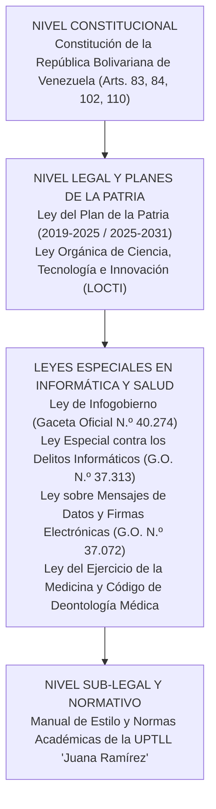

# FASE II: REVISIÓN LITERARIA (EL SOPORTE CIENTÍFICO)

**Enfoque: Sustento científico, referencial y legal.**

La Fase II comprende el soporte teórico, científico y normativo que fundamenta la investigación, contextualizando el desarrollo del sistema web dentro de un cuerpo de conocimientos rigurosamente validados en el campo de la ingeniería de software y la informática aplicada a la salud.

---

## Antecedentes de la Investigación

De conformidad con las directrices académicas de la UPTLLJR, se seleccionaron investigaciones previas de carácter internacional (03) y nacional/regional (03) directamente relacionadas con sistemas de historias clínicas, plataformas web asistenciales y seguridad informática médica.

### Antecedentes Internacionales

1. **Gómez, R. y Mendoza, L. (2023)**, en Colombia, desarrollaron un trabajo de grado titulado *"Diseño e implementación de un sistema web para el control de historias clínicas y asignación de citas en un centro de atención materno-infantil en Bogotá"*, presentado en la Universidad Distrital Francisco José de Caldas. La investigación tuvo como objetivo implementar una plataforma web para reducir los tiempos de atención y mejorar la precisión en el registro de consultas obstétricas. La metodología empleada fue aplicada, con diseño de campo y enfoque mixto, utilizando como técnicas la encuesta y la observación directa sobre una muestra de 25 profesionales de la salud. Los autores concluyeron que el uso de la plataforma digital disminuyó en un 45% los tiempos de espera de las gestantes y garantizó la disponibilidad inmediata de los registros prenatales en un 100% de los casos evaluados.  
   *Aporte a la investigación*: Este antecedente aporta a nuestro proyecto la estructura metodológica para evaluar el impacto en los tiempos de espera asistenciales y valida la efectividad del uso de plataformas web en la especialidad médica integral en el contexto latinoamericano. Asimismo, brinda pautas para la confección de formularios orientados a controles prenatales periódicos, diferenciándose el presente trabajo al incorporar un esquema de sincronización reactiva en tiempo real, un tablero Kanban de Sala de Espera y una arquitectura de desbloqueo criptográfico con PIN local para la sesión del especialista.

2. **Castillo, E. y Paredes, S. (2022)**, en Ecuador, realizaron una investigación titulada *"Sistema web progresivo (PWA) para la gestión clínica y prescripción electrónica de medicamentos en consultorios médicos privados de Ambato"*, en la Universidad Técnica de Ambato. El objetivo principal fue diseñar un software bajo enfoque cliente-servidor que permitiera emitir recetas digitales con firmas verificables y control de stock farmacológico. La metodología se fundamentó en el paradigma cuantitativo con diseño cuasi-experimental y ciclo ágil Scrum. Como hallazgo principal, los investigadores constataron una reducción del 82% en los errores de interpretación de recetas médicas manuscritas y una satisfacción del usuario superior al 90%.  
   *Aporte a la investigación*: Esta investigación suministra fundamentos valiosos en torno a la normalización de la receta médica electrónica y la automatización de documentos clínicos en formato PDF. Aporta directamente a nuestro proyecto los criterios de estructuración visual del récipe médico, órdenes paraclínicas e informes ecográficos (RP, indicaciones, perfiles diagnósticos, datos de la paciente y credenciales del especialista), permitiendo diseñar en FemeSalud generadores interactivos que producen documentos oficiales exportables a PDF y listos para su remisión vía WhatsApp.

3. **Martínez, A., Sánchez, D. y Ortiz, F. (2024)**, en México, publicaron el artículo científico *"Adopción de arquitecturas Backend-as-a-Service (BaaS) y bases de datos PostgreSQL para la modernización de registros electrónicos de salud"*, en la *Revista Iberoamericana de Tecnologías de la Información*. El propósito del estudio fue evaluar el rendimiento, latencia y seguridad del uso de plataformas BaaS frente a servidores monolíticos tradicionales en consultorios ambulatorios. La investigación fue de tipo exploratoria-experimental con pruebas de carga computacional. Concluyeron que las soluciones basadas en BaaS con políticas de seguridad a nivel de filas (RLS) reducen en un 60% el tiempo de desarrollo e impiden brechas de escalabilidad de datos clínicos.  
   *Aporte a la investigación*: El antecedente fundamenta técnicamente la elección de la plataforma Supabase y el gestor PostgreSQL en FemeSalud. Aporta la validación empírica de que el modelo BaaS ofrece alta disponibilidad, cifrado en tránsito y sincronización por sockets en tiempo real sin requerir una infraestructura de servidores pesada o de costoso mantenimiento local, lo cual resulta idóneo para la realidad tecnológica y económica de los centros de salud ambulatorios venezolanos.

---

### Antecedentes Nacionales y Regionales

1. **Rondón, J. y Alvarado, M. (2023)**, en San Juan de los Morros, Estado Guárico, presentaron en la Universidad Nacional Experimental Rómulo Gallegos (UNERG) el proyecto titulado *"Sistema automatizado para la gestión de expedientes clínicos y control de citas médicas en el Centro Clínico Universitario"*. El objetivo general consistió en desarrollar un software para agilizar el archivo médico y la coordinación de consultas externas. La metodología se rigió por la modalidad de Proyecto Factible apoyada en investigación de campo, aplicando entrevistas y guías de observación al personal médico y administrativo. Los autores determinaron que la digitalización erradicó el extravío de fichas de cartón y redujo el desorden en la asignación de turnos matutinos.  
   *Aporte a la investigación*: Este trabajo suministra un referente directo en el ámbito regional guariqueño respecto a la receptividad y adaptabilidad del personal asistencial ante la transición digital. Aporta los requerimientos esenciales del flujo de admisión de pacientes y demuestra la viabilidad de implementar sistemas clínicos en la entidad, sirviendo de base comparativa para nuestra investigación, la cual profundiza en la especialización médica multiespecialidad, en el control visual de Sala de Espera y en la experiencia de usuario táctil para dispositivos móviles.

2. **Hernández, K. y Morales, G. (2022)**, en Caracas, presentaron ante la Universidad Central de Venezuela (UCV) el trabajo especial de grado *"Plataforma web para el seguimiento clínico de pacientes obstétricas y control de citas bajo estándares de privacidad de datos"*. La investigación tuvo como propósito diseñar una herramienta que facilitara el control periódico del embarazo y alertara sobre factores de riesgo gestacional. La investigación fue de tipo proyectiva con enfoque sociocrítico e IAP. Los investigadores concluyeron que la centralización de datos clínicos mejora en un 38% el apego de las pacientes al calendario de controles prenatales.  
   *Aporte a la investigación*: El estudio aporta elementos esenciales para la definición de los campos médicos de la historia obstétrica (cálculo de edad gestacional por FUM, fecha probable de parto por regla de Naegele, antecedentes clínico integrals G-P-A-C, curvas de constantes vitales y ecografías de control). Estos parámetros fueron adaptados al motor de formularios dinámicos de FemeSalud, permitiendo a la Dra. Carli Sole (y equipo médico) registrar de forma rápida y estructurada cada variable biomédica crítica.

3. **Torres, V. y Bravo, P. (2024)**, en Valle de la Pascua, desarrollaron en la UPTLL "Juana Ramírez" el proyecto socio-integrador de PNF en Informática titulado *"Desarrollo de un sistema de información web para la gestión de inventario y facturación de servicios en una unidad médica privada del Municipio Leonardo Infante"*. La investigación persiguió automatizar la cobranza multimoneda y el control de suministros médicos. Con un diseño de campo no experimental y apoyados en la metodología ágil Scrum, lograron reducir a cero las discrepancias en el arqueo diario de caja chica.  
   *Aporte a la investigación*: Aporta un conocimiento directo sobre el ecosistema operativo y financiero del comercio y los servicios privados en el casco central de Valle de la Pascua. Permite estructurar en nuestro proyecto los módulos de facturación post-consulta, cuentas de tesorería, arqueo diario Reporte Z y liquidación matemática de honorarios médicos (`/honorarios`), integrando los métodos de pago venezolanos (**Pago Móvil, Transferencia Bancaria, Efectivo en Bolívares, Divisas USD/EUR, Binance Pay USDT y Cashea**) vinculados al servicio clínico prestado.

---

## Bases Teóricas

El desarrollo del sistema web MediZen se fundamenta en los siguientes conceptos, modelos y teorías de la ciencia computacional y la informática médica:

### Sistemas de Información en Salud (HIS) y Expedientes Clínicos Electrónicos (EHR)
Un Sistema de Información en Salud (*Hospital Information System*, HIS) es un conjunto organizado de componentes tecnológicos, humanos y procedimentales diseñados para capturar, almacenar, procesar y comunicar datos relacionados con la atención médica y la gestión administrativa de los pacientes (Shortliffe & Cimino, 2020). Dentro de estos sistemas, el Expediente Clínico Electrónico (*Electronic Health Record*, EHR) representa el repositorio digital longitudinal de la información de salud de una persona, el cual incluye identificación unívoca (`HC`), datos demográficos, grupo sanguíneo y factor Rh, contacto de emergencia, cobertura de seguro, antecedentes patológicos, quirúrgicos y familiares, alergias, medicación habitual, historial transfusional, evoluciones clínicas, curvas de constantes vitales, estudios paraclínicos adjuntos y tratamientos farmacológicos (O’Mahony, 2021).  
*Relación con el proyecto*: FemeSalud (Medizen) implementa un EHR normado adaptado a la medicina ambulatoria privada en las tablas `pacientes`, `historias_clinicas`, `consultas` y `archivos_pacientes`, sustituyendo el archivo físico en papel por un registro digital centralizado con alertas clínicas visibles en cabecera (`PatientClinicalBanner`), curvas longitudinales de signos vitales (`PatientVitalsChart`) y línea de tiempo evolutiva (`PatientTimeline`).

### Flujos Clínicos Especializados en Múltiples Especialidades Médicas y Regla de Naegele
La práctica médica integral exige parámetros clínicos específicos que difieren de la medicina general (Schorge et al., 2021). En el ámbito gineco-obstétrico destacan la fórmula obstétrica (Gestas, Para, Cesáreas, Abortos, Embarazo Ectópico y Molar), la Fecha de Última Menstruación (FUM), el cálculo automático de la Edad Gestacional (EG) en semanas y días cumplidos, y la Fecha Probable de Parto (FPP) determinada mediante la **Regla de Naegele** (sumando 280 días o 40 semanas a partir del primer día de la FUM), además del registro de signos vitales con seguimiento gráfico de tensión arterial y cálculo automático de Índice de Masa Corporal (IMC), órdenes de laboratorio por perfiles diagnósticos e informes ecográficos estructurados.  
*Relación con el proyecto*: El sistema modela estas variables tanto en el expediente base como en las consultas especializadas, ejecutando los cálculos obstétricos y antropométricos de forma automática al ingresar la FUM o el peso/talla de la paciente y generando órdenes paraclínicas e informes ecográficos en PDF.

### Arquitectura Web Moderna y Progresiva (PWA) con React 19, Caché L1/L2 y TypeScript
Una aplicación de página única (*Single Page Application*, SPA) con capacidades de Aplicación Web Progresiva (*Progressive Web App*, PWA) interactúa con el usuario reescribiendo dinámicamente la vista activa con soporte de instalación nativa y caché inteligente mediante *Service Workers* (Banks & Porcello, 2023). **React 19** introduce mejoras en el renderizado concurrente, **TanStack Router / Start** provee enrutamiento con seguridad de tipos e hidratación cliente-servidor sin pérdida de sesión, **TanStack Query v5** articulado con almacenamiento persistente conforma una **caché multinivel L1 (memoria) + L2 (`localStorage` en `persistentQueryCache.ts`)** con hidratación instantánea en `0 ms`, **`@tanstack/charts`** ofrece visualización analítica declarativa, y **TypeScript 5.8** sobre **Vite 7** y **Bun** garantiza tipado estático de extremo a extremo verificable mediante análisis estático especializado (`react-doctor`) (Bierman et al., 2022).  
*Relación con el proyecto*: FemeSalud utiliza esta pila tecnológica junto con carga diferida (*code splitting*) de motores documentales pesados (`jsPDF`), logrando transiciones instantáneas en `0 ms` entre módulos (Dashboard, Sala de Espera Kanban, Agenda, Pacientes, Expediente Clínico, Ventas, Honorarios Médicos, Inventario, Reportes y Auditoría), tiempos de respuesta a la interacción (*INP*) inferiores a 50 ms y una puntuación perfecta de **100 / 100 en `react-doctor`**.

### Backend-as-a-Service (BaaS), PostgreSQL, RBAC por Alcance y Políticas RLS
El modelo *Backend-as-a-Service* (BaaS) permite delegar la gestión del motor relacional, el almacenamiento de archivos en la nube (*Storage*), los canales de sincronización por WebSockets y la autenticación JWT en una infraestructura segura (Kaur & Singh, 2022). **Supabase**, construido sobre **PostgreSQL 15**, provee integridad transaccional ACID, suscripciones en vivo (*Supabase Realtime*) con control de ráfagas (*debounce* de `350 ms`) y seguridad a nivel de filas (*Row Level Security*, RLS), complementada con aislamiento estricto de alcance por rol clínico (`useUserRoleScope`) y bitácoras inmutables de auditoría (`auditoria_logs` / `/auditoria`).  
*Relación con el proyecto*: Garantiza que cualquier cambio en sala de espera, citas, pacientes, consultas, facturación post-consulta, honorarios o movimientos de inventario se refleje al instante en las estaciones autorizadas, asegurando que cada médico visualice únicamente su cartera de pacientes y métricas propias mientras recepción coordina la atención global y administración controla tesorería, honorarios, inventario y auditoría.

### Bóveda Criptográfica en el Cliente: Web Crypto API, PBKDF2, AES-GCM y Bloqueo por Inactividad
La *Web Cryptography API* es una interfaz estándar del W3C que permite ejecutar primitivas criptográficas nativas en el navegador (W3C, 2022). Para garantizar que la estación médica sea ágil pero inexpugnable mediante un **código PIN de 4 dígitos**, se emplea la función de derivación de claves `PBKDF2` (*Password-Based Key Derivation Function 2* con 100.000 iteraciones SHA-256 y sal aleatoria de 16 bytes) combinada con el cifrado autenticado `AES-GCM` de 256 bits y verificación de PIN mediante *hash* SHA-256 con sal criptográfica.  
*Relación con el proyecto*: Permite desbloquear la sesión médica en menos de un segundo sin almacenar jamás contraseñas ni códigos PIN en texto plano en `localStorage`, incorporando además limitación de intentos contra ataques de fuerza bruta (bloqueo temporal tras 5 intentos fallidos) y bloqueo automático o manual de pantalla por inactividad (`InactivityLockOverlay`).

---

## Bases Legales (Pirámide de Kelsen)

El desarrollo, despliegue y puesta en marcha del sistema web MediZen se fundamenta estrictamente en el ordenamiento jurídico de la República Bolivariana de Venezuela, organizado jerárquicamente bajo la estructura de la Pirámide de Kelsen.

**Figura 4**  
*Pirámide de Kelsen Aplicada al Marco Legal del Software Clínico MediZen*

*Nota.* Elaboración propia (2026), según la jerarquía normativa de la República Bolivariana de Venezuela.

1. **Constitución de la República Bolivariana de Venezuela (Gaceta Oficial N.º 5.908 Extraordinario, 2009)**:
   * **Artículo 83**: Establece la salud como un derecho social fundamental y deber indeclinable del Estado, garantizando la calidad de vida de la población. El proyecto coadyuva a la prestación de un servicio ginecológico y de salud materna eficiente.
   * **Artículo 110**: El Estado reconoce el interés público de la ciencia, la tecnología, el conocimiento y la innovación como instrumentos fundamentales para el desarrollo económico y social del país. Fundamenta el derecho y deber de los estudiantes del PNF de desarrollar soluciones informáticas soberanas.

2. **Ley del Plan de la Patria (Plan de Desarrollo Económico y Social de la Nación)**:
   * Vinculado con el **Gran Objetivo Histórico N.º 1**: *"Defender, expandir y consolidar el bien más preciado que hemos reconquistado tras 200 años: la Independencia Nacional"*, a través del desarrollo de capacidades científico-tecnológicas aplicadas a las prioridades nacionales de salud y bienestar del pueblo.

3. **Ley Orgánica de Ciencia, Tecnología e Innovación (LOCTI - Gaceta Oficial N.º 39.575)**:
   * Promueve la aplicación del conocimiento tecnológico para elevar la productividad y bienestar de los sectores productivos y de servicios, respaldando el desarrollo de software autóctono en las universidades territoriales.

4. **Ley de Infogobierno (Gaceta Oficial N.º 40.274)**:
   * Establece principios de eficacia, transparencia, seguridad de los datos e interoperabilidad en el manejo de registros electrónicos e informáticos en el país.

5. **Ley Especial contra los Delitos Informáticos (Gaceta Oficial N.º 37.313)**:
   * Protege los sistemas tecnológicos y la privacidad de la información. El sistema MediZen implementa mecanismos de control de acceso, auditoría y cifrado para impedir el acceso indebido (Art. 6) y la revelación indebida de datos reservados (Art. 20).

6. **Ley sobre Mensajes de Datos y Firmas Electrónicas (Gaceta Oficial N.º 37.072)**:
   * Otorga plena validez jurídica a los documentos y récipes generados en formato digital (PDF), reconociendo su autenticidad y valor probatorio en el ejercicio profesional.

7. **Ley del Ejercicio de la Medicina y Código de Deontología Médica de Venezuela**:
   * Normativa que exige el resguardo escrupuloso de la historia clínica médica, el secreto profesional y la custodia inviolable de la información confidencial de las pacientes.

---

## Sistema de Variables y Operacionalización

De acuerdo con lo establecido en el manual de la UPTLLJR (pág. 18-19 y pág. 47 del Anexo B/C de PNF en Informática), se desglosa la variable independiente (la solución tecnológica) y la variable dependiente (el problema operativo a optimizar).

* **Variable Independiente (Causa / Solución)**: *Sistema Web para la Gestión de Historias Clínicas Médicas Multiespecialidad y Control Operativo (FemeSalud)*.
* **Variable Dependiente (Efecto / Fenómeno a transformar)**: *Optimización de la Gestión de Historias Clínicas y el Flujo Operativo en el Consultorio*.

**Tabla 4**  
*Matriz de Operacionalización de Variables*

| Variable | Definición Conceptual | Definición Operacional | Dimensiones | Indicadores | Escala de Medición |
| :--- | :--- | :--- | :--- | :--- | :--- |
| **Variable Independiente:** Sistema Web para la Gestión de Historias Clínicas y Control Operativo | Aplicación informática modular que permite capturar, resguardar y sincronizar historias clínicas médicas multiespecialidad, turnos en sala de espera, emisión de documentos clínicos y registros financieros en una organización médica (Shortliffe & Cimino, 2020). | Implementación de una plataforma web reactiva desarrollada en React 19, TypeScript y Supabase (PostgreSQL), con caché L1/L2 (`0 ms`), PIN criptográfico, aislamiento por rol médico, Sala de Espera Kanban, récipes/órdenes PDF y tesorería con Reporte Z y honorarios, evaluada en FemeSalud. | - Expediente Clínico y Curvas Vitales - Sala de Espera Kanban y Agenda - Récipes, Laboratorio y Ecografía PDF - Seguridad PIN, RBAC y Auditoría - Facturación, Reporte Z y Honorarios | - Tiempo de registro por paciente (segundos) - Precisión en cálculo obstétrico (FUM/FPP) - Tiempo de emisión de documentos clínicos PDF (s) - Latencia de desbloqueo PIN y caché L1/L2 (ms) - Puntaje de calidad estática `react-doctor` (0-100) | Razón Razón Razón Razón Razón |
| **Variable Dependiente:** Optimización de la Gestión de Historias Clínicas y Flujo Operativo | Nivel de mejora alcanzado en la administración de la clínica médico, reflejado en la reducción de tiempos de atención, erradicación de pérdidas documentales, seguridad de datos y fluidez operativa global (Hernández et al., 2022). | Medición cuantitativa y cualitativa comparando indicadores de desempeño antes y después de la implantación del sistema web, evaluando tiempos de espera, extravío de expedientes, conciliación contable y satisfacción de la especialista. | - Tiempos de Atención y Espera - Integridad y Custodia Documental - Eficiencia Financiera y Contable - Satisfacción de la Usuaria y Médico | - Minutos promedio de espera en sala por paciente - Porcentaje de expedientes extraviados o deteriorados - Exactitud en liquidación de caja (Reporte Z) y honorarios - Puntaje de usabilidad SUS y escala Likert (1-5) | Intervalo / Razón Razón Razón Ordinal / Razón |

*Nota.* Elaboración propia (2026), adaptado fielmente del modelo oficial de operacionalización para PNF en Informática de la UPTLLJR (pág. 47 del manual).
